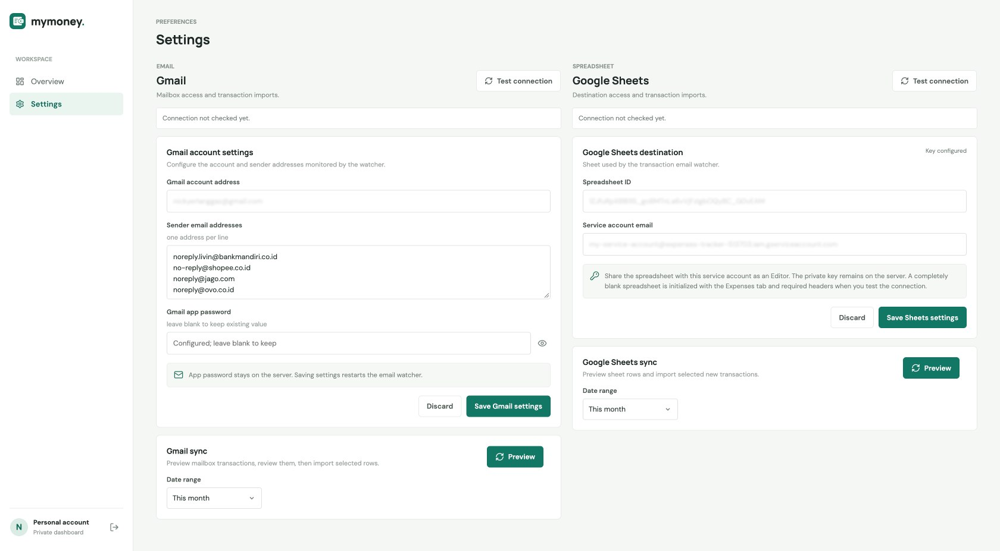

<p align="center">
  
</p>

<h1 align="center">MyMoney</h1>

<p align="center">A self-hosted personal finance dashboard with SQLite-backed reporting and preview-first Gmail and Google Sheets imports.</p>

## Features

- Monthly income, expenses, net cash flow, category breakdown, and daily spending activity
- Manual transaction creation and editing, plus CSV export
- Gmail transaction capture using an IMAP IDLE daemon and sender-specific parsers
- Google Sheets output using a server-side service account
- Separate Gmail and Google Sheets sync previews, with selectable imports
- Matching by email Message-ID, conflict review, and no automatic deletion or overwrite of dashboard transactions
- Date filters for today, this week, this month, this year, or a custom range
- Settings checks for Gmail and Sheets access, including the configured service-account identity

## Screenshots

### Sign in


### Settings



### Overview


## Tech Stack

- React, TypeScript, Vite, Recharts, and Lucide
- FastAPI and SQLite
- Gmail over IMAP and Google Sheets through `gspread`
- Uvicorn, with systemd available for long-running services

## How It Works

SQLite is the dashboard’s source of truth. The frontend talks to the FastAPI API under `/api`. The Gmail watcher parses supported incoming email and writes transactions to SQLite and the configured Google Sheet.

Manual sync is separate from the watcher. It reads Gmail or the `Expenses` sheet, presents a preview, and imports only rows the user selects into SQLite. Gmail preview is read-only and uses `BODY.PEEK[]`; it does not mark messages read. Sync does not write to Gmail or Sheets, overwrite conflicting transactions, or delete dashboard transactions because a row is absent from a source.

## Requirements

- Python 3.11 or newer
- Node.js and npm
- A Gmail account with IMAP enabled and a Gmail app password
- A Google Cloud service account with the Google Sheets API enabled
- The target spreadsheet shared with the service account as an Editor

The expected worksheet is named `Expenses`, with these columns in order:

```text
Date | Source | Merchant | Amount | Category | Payment Method | Email Link
```

An entirely blank spreadsheet can be initialized by **Test connection** in Settings. The app creates the `Expenses` tab and header only when it finds no existing worksheet data. Existing data with an unexpected header is left untouched and reported for manual correction.

## Local Setup

Clone the repository, then from its root create and activate a virtual environment:

```bash
python3 -m venv .venv
source .venv/bin/activate
python -m pip install --upgrade pip
python -m pip install fastapi 'uvicorn[standard]' gspread google-auth pydantic python-multipart
```

Install frontend dependencies and build the app:

```bash
cd web/frontend
npm ci
npm run build
cd ../..
```

Create `config.json` in the repository root. Keep the real file private and replace every example value:

```json
{
  "gmail_user": "your-account@gmail.com",
  "gmail_app_password": "your-gmail-app-password",
  "senders": ["bank-notifications@example.com"],
  "spreadsheet_id": "your-google-spreadsheet-id"
}
```

Place the Google service-account key at `service_account.json` in the repository root, then share the spreadsheet with the `client_email` from that key. Never paste or commit the private key.

Initialize the dashboard password from a private shell. The utility prompts for a password and refuses to replace one already configured:

```bash
cd web/backend
../../.venv/bin/python password_setup.py
```

Run the API locally from `web/backend`:

```bash
cd web/backend
../../.venv/bin/uvicorn app:app --host 127.0.0.1 --port 8017
```

The API serves the built frontend from `web/frontend/dist`. The email watcher is a separate process and is not started by the command above; review `expense-daemon.service` before running it in a suitable server environment.

## Settings and Credentials

Settings lets you configure the Gmail account, watched senders, and spreadsheet ID. The service-account email is displayed read-only; its private key remains on the server. The Gmail password is never returned by the settings API. Saving settings updates `config.json` with restrictive file permissions and restarts the watcher service.

Keep `config.json`, `service_account.json`, `.env`, database files, email contents, and passwords out of Git. The repository `.gitignore` covers the primary local credential and data files. Review `git status` before publishing and add any deployment-specific secrets or artifacts to ignore rules before staging.

Do not expose Uvicorn directly to the public internet. Use an HTTPS reverse proxy, restrict access to credential files, and retain the app’s authentication and CSRF protections.

## Sync Behavior

### Google Sheets

In Settings, test the connection, choose a date range, preview the `Expenses` worksheet, review the classifications, and import selected new rows. Matching rows are reported; conflicts are displayed but not applied. Invalid and duplicate rows are reported. The app does not edit sheet rows.

Rows without an email Message-ID use a content-derived identity. Editing a manual sheet row can therefore make it appear as a new row on a later preview. Review those rows before applying them.

### Gmail

In Settings, test the connection, choose a date range, and preview messages from configured sender addresses. Gmail access is tested using IMAP login and read-only inbox selection. Preview fetches messages with `BODY.PEEK[]`. Only selected new transactions are imported; matched rows and conflicts are not reapplied.

Parsing is sender-specific. Unsupported or unrecognized messages are reported rather than imported automatically.

## Build and Tests

```bash
cd web/frontend
npm ci
npm run build

cd ../backend
../../.venv/bin/python -m py_compile app.py tests/sync_smoke.py
../../.venv/bin/python tests/sync_smoke.py
```

The smoke tests use temporary SQLite storage and mocked Gmail/Sheets responses. They cover preview/apply behavior, read-only Gmail access, connection checks, blank-sheet initialization safeguards, and valid settings-file writes. They do not access live accounts or the production spreadsheet.

## Deployment Notes

A typical deployment runs Uvicorn under systemd bound to loopback and proxies it through Nginx with HTTPS. Run the email watcher as a separate systemd service using the supplied unit as a starting point; adapt its paths and security settings to your environment. Do not copy private hostnames, credentials, or production data into this repository.

After backend or frontend changes, build the frontend, deploy the updated application files, and restart the relevant service. Verify `/api/health`, sign-in, Settings, and both connection checks. For imports, inspect the preview and selected rows before applying. This README does not define a one-size-fits-all deployment script because service names and paths are installation-specific.

## Data and Backups

The default database path is `web/transactions.db`; set `EXPENSE_DB` to use a different path. Back up the database before upgrades or imports. Use SQLite’s backup API or another consistent snapshot method while the database is active. Do not commit database files.

## Troubleshooting

- **Settings returns a server error:** check that `config.json` is valid JSON. A settings save must leave a valid JSON file; inspect the API service log for the traceback.
- **Gmail connection fails:** confirm IMAP is enabled, the app password is current, and the API service uses the expected Python environment.
- **Gmail watcher fails after saving Settings:** inspect the watcher service logs and verify it can read `config.json` and `service_account.json`.
- **Sheets connection fails:** verify the spreadsheet ID, service-account key, Sheets API, Editor sharing, and `Expenses` tab header.
- **An existing sheet is not initialized:** if any worksheet contains data or `Expenses` has an unexpected header, the app intentionally avoids changing it. Correct the sheet manually, then test again.
- **Frontend changes do not appear:** rebuild the frontend, deploy the new `dist` files, and reload the browser after checking that `dist/index.html` references the latest hashed assets.
- **A row appears as a conflict:** compare its date, transaction type, amount, description, category, and payment method with the SQLite record. Conflicts are review-only.

## License

This project is licensed under the MIT License. See [`LICENSE`](LICENSE) for the full text.
