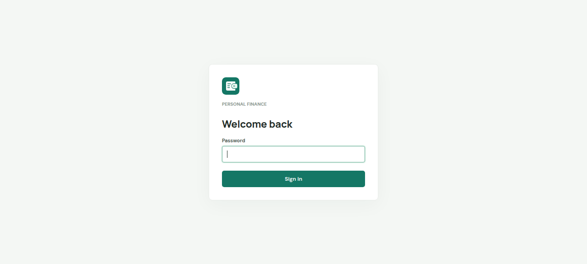
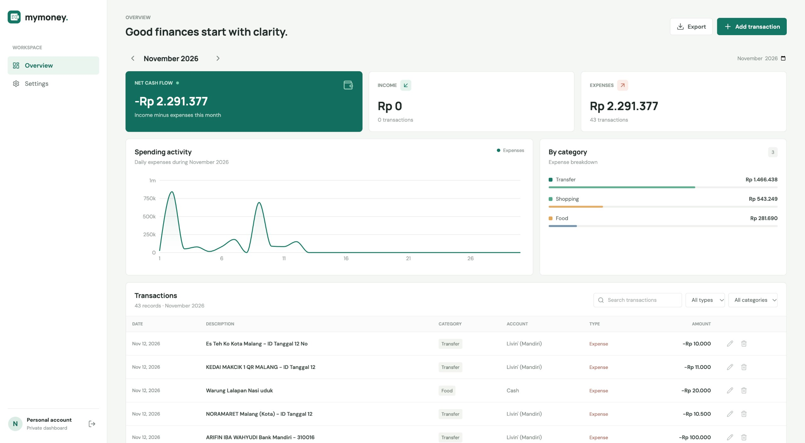

<p align="center">
  
</p>

<h1 align="center">MyMoney</h1>

<p align="center">A self-hosted personal finance dashboard with SQLite-backed reporting and preview-first Gmail and Google Sheets imports.</p>

<p align="center"><a href="https://demo.mymoney.kynic.my.id">Try the live demo</a></p>

## Features

- Monthly income, expenses, net cash flow, category breakdown, and daily spending activity
- Manual transaction creation and editing, plus CSV export
- Gmail transaction capture using an IMAP IDLE daemon and sender-specific parsers
- Google Sheets output using a server-side service account
- Separate Gmail and Google Sheets sync previews, with selectable imports
- Matching by email Message-ID, conflict review, and no automatic deletion or overwrite of dashboard transactions
- Date filters for today, this week, this month, this year, or a custom range
- Settings checks for Gmail and Sheets access, including the configured service-account identity

## Screenshots

### Sign in



### Settings


### Overview



## Tech Stack

- React, TypeScript, Vite, Recharts, and Lucide
- FastAPI and SQLite
- Gmail over IMAP and Google Sheets through `gspread`
- Uvicorn, with systemd available for long-running services

## How It Works

SQLite is the dashboard’s source of truth. The frontend talks to the FastAPI API under `/api`. The Gmail watcher parses supported incoming email and writes transactions to SQLite and the configured Google Sheet.

Manual sync is separate from the watcher. It reads Gmail or the `Expenses` sheet, presents a preview, and imports only rows the user selects into SQLite. Gmail preview is read-only and uses `BODY.PEEK[]`; it does not mark messages read. Sync does not write to Gmail or Sheets, overwrite conflicting transactions, or delete dashboard transactions because a row is absent from a source.

## Requirements

- Python 3.11 or newer
- Node.js 20.19+ or 22.12+ and npm (Vite 8 requirement)
- A Gmail account with IMAP enabled and a Gmail app password
- **Optional** — Google Cloud service account + spreadsheet (only for Google Sheets mirroring; manual tracking and Gmail capture work without it)

The expected worksheet is named `Expenses`, with these columns in order:

```text
Date | Source | Merchant | Amount | Category | Payment Method | Email Link
```

An entirely blank spreadsheet can be initialized by **Test connection** in Settings. The app creates the `Expenses` tab and header only when it finds no existing worksheet data. Existing data with an unexpected header is left untouched and reported for manual correction.

## Local Setup

Follow the steps below, or see [`docs/AGENT_INSTALL.md`](docs/AGENT_INSTALL.md) for a guided, agent-oriented install tutorial.

Clone the repository, then from its root create and activate a virtual environment:

```bash
python3 -m venv .venv
source .venv/bin/activate
python -m pip install --upgrade pip
python -m pip install -r requirements.txt
```

Install frontend dependencies and build the app:

```bash
cd web/frontend
npm ci
npm run build
cd ../..
```

Create `config.json` in the repository root. Keep the real file private and replace every example value:

```json
{
  "gmail_user": "your-account@gmail.com",
  "gmail_app_password": "your-gmail-app-password",
  "senders": ["bank-notifications@example.com"],
  "spreadsheet_id": ""
}
```

`spreadsheet_id` is optional — leave it empty to disable Google Sheets mirroring (manual tracking and Gmail capture still work). To enable mirroring, fill it in and also place the service-account key as described below.

Place the Google service-account key at `service_account.json` in the repository root, then share the spreadsheet with the `client_email` from that key. Never paste or commit the private key.

#### Google account, service account, and Gmail app password setup

Follow [`docs/GOOGLE_SETUP.md`](docs/GOOGLE_SETUP.md) for the full walkthrough: creating the Google Cloud account, enabling the Google Sheets API (the only Cloud API needed — Gmail is accessed over IMAP, not the Gmail API), creating the service account and its JSON key, generating a Gmail app password, and preparing the spreadsheet.

In short, you end up with:

- `service_account.json` in the repository root (Sheets access)
- A 16-character Gmail app password in `config.json` (email capture)
- The target spreadsheet shared with the service account as **Editor**

Initialize the dashboard password. On **first visit** the app shows a **Create your password** screen — use that. Alternatively (e.g. headless installs), use the CLI utility, which refuses to replace an already-configured password:

```bash
cd web/backend
../../.venv/bin/python password_setup.py
```

Run the API locally from `web/backend`:

```bash
cd web/backend
../../.venv/bin/uvicorn app:app --host 127.0.0.1 --port 8017
```

The API serves the built frontend from `web/frontend/dist`. The email watcher is a separate process and is not started by the command above; review `expense-daemon.service` before running it in a suitable server environment.

#### Verify it works

1. Open `http://127.0.0.1:8017` in a browser — you should see the sign-in page.
2. Check the health endpoint:
   ```bash
   curl http://127.0.0.1:8017/api/health
   # {"status":"ok"}
   ```
3. (Optional) Run the smoke tests to confirm the backend behaves correctly:
   ```bash
   cd web/backend
   ../../.venv/bin/python tests/sync_smoke.py
   ```

#### Run the email watcher locally (for testing)

The Gmail watcher is a long-running IMAP IDLE process. To try it locally, run it from the repository root in its own process/session:

```bash
cd /path/to/expense-tracker
source .venv/bin/activate
python tracker_daemon.py
```

It logs to stdout and stays running; Ctrl+C stops it. In production, run it as a systemd service instead (see [Deployment Notes](#deployment-notes)).

## Settings and Credentials

Settings lets you configure the Gmail account, watched senders, and spreadsheet ID. The service-account email is displayed read-only; its private key remains on the server. The Gmail password is never returned by the settings API. Saving settings updates `config.json` with restrictive file permissions and restarts the watcher service.

Keep `config.json`, `service_account.json`, `.env`, database files, email contents, and passwords out of Git. The repository `.gitignore` covers the primary local credential and data files. Review `git status` before publishing and add any deployment-specific secrets or artifacts to ignore rules before staging.

Do not expose Uvicorn directly to the public internet. Use an HTTPS reverse proxy, restrict access to credential files, and retain the app’s authentication and CSRF protections.

## Sync Behavior

### Google Sheets

In Settings, test the connection, choose a date range, preview the `Expenses` worksheet, review the classifications, and import selected new rows. Matching rows are reported; conflicts are displayed but not applied. Invalid and duplicate rows are reported. The app does not edit sheet rows.

Rows without an email Message-ID use a content-derived identity. Editing a manual sheet row can therefore make it appear as a new row on a later preview. Review those rows before applying them.

### Gmail

In Settings, test the connection, choose a date range, and preview messages from configured sender addresses. Gmail access is tested using IMAP login and read-only inbox selection. Preview fetches messages with `BODY.PEEK[]`. Only selected new transactions are imported; matched rows and conflicts are not reapplied.

Parsing is sender-specific. Unsupported or unrecognized messages are reported rather than imported automatically.

## Build and Tests

```bash
cd web/frontend
npm ci
npm run build

cd ../backend
../../.venv/bin/python -m unittest discover -s tests -p 'test_*.py' -v
../../.venv/bin/python -m py_compile app.py tests/sync_smoke.py tests/test_transaction_parser.py
../../.venv/bin/python tests/sync_smoke.py
```

The smoke tests use temporary SQLite storage and mocked Gmail/Sheets responses. They cover preview/apply behavior, read-only Gmail access, connection checks, blank-sheet initialization safeguards, and valid settings-file writes. They do not access live accounts or the production spreadsheet.

## Deployment Notes

A typical deployment runs Uvicorn under systemd bound to loopback and proxies it through Nginx with HTTPS. Run the email watcher as a separate systemd service using the supplied unit as a starting point; adapt its paths and security settings to your environment. Do not copy private hostnames, credentials, or production data into this repository.

After backend or frontend changes, build the frontend, deploy the updated application files, and restart the relevant service. Verify `/api/health`, sign-in, Settings, and both connection checks. For imports, inspect the preview and selected rows before applying. This README does not define a one-size-fits-all deployment script because service names and paths are installation-specific.

## Run with Docker

The dashboard-only Docker install needs Docker and Docker Compose v2; it does not require Gmail credentials or Google Cloud setup.

### Start the dashboard (manual tracking)

```bash
docker compose up -d --build
```

Open `http://localhost:8017`. On first run, create a password. Manual transactions work immediately; Gmail capture and Sheets mirroring can be configured later.

### Optional Gmail capture

Gmail capture is run by a separate watcher. First configure a Gmail account and app password in Settings. For Sheets mirroring, also place `service_account.json` in the project root and share the spreadsheet with its service-account email. Then start the watcher profile:

```bash
docker compose --profile gmail up -d --build
```

Do not enable the Gmail profile until the credentials required by the watcher are configured.

### Stop

```bash
docker compose down
```

### Rebuild after code changes

```bash
docker compose build --no-cache
docker compose up -d
```

### Credentials and data

The SQLite database and generated `config.json` are stored in the named `mymoney-data` volume at `/app/data`; they are not baked into the image or stored in the repository checkout. Google service-account credentials are only mounted when using the Gmail profile. Back up the named volume before upgrades or migrations.

### Health check

The backend exposes `http://localhost:8017/api/health`. Compose waits for it to become healthy before starting the optional watcher.


## Data and Backups

The database and generated `config.json` are stored together in the named `mymoney-data` volume at `/app/data`. They are not baked into the image or kept in the checkout. The archive contains both files and must be treated as sensitive because `config.json` can include Gmail credentials. Restrict access to backups and store a copy away from the server. If Gmail/Sheets are enabled, `service_account.json` is mounted from the project directory and is not included; back it up separately using a secure method.

### Create a Docker backup

Run from the project directory while MyMoney is running; the script reads the volume read-only and creates a consistent SQLite snapshot archive with restrictive permissions:

```bash
./scripts/backup-docker-volume.sh
```

By default the archive is written to `./backups/` with mode `600`, and the directory is mode `700`. Choose another protected location if backups should not remain on the same server:

```bash
./scripts/backup-docker-volume.sh /secure/backup/location
```

The volume can be selected with `MYMONEY_VOLUME` if you changed its name.

### Restore a Docker backup

Restore replaces the contents of the selected volume. Stop MyMoney first, and keep a separate copy of the current volume before restoring:

```bash
docker compose --profile gmail down
./scripts/restore-docker-volume.sh /secure/backup/location/mymoney-mymoney-data-TIMESTAMP.tar.gz --force
docker compose up -d --build
```

The restore script validates the archive, config JSON, and SQLite integrity before changing the volume. Without `--force`, it refuses to replace a non-empty volume. After restart, verify `http://localhost:8017/api/health`, sign in, and confirm expected transactions and Settings. If the Gmail profile is used, restore `service_account.json` separately before enabling it.

To restore into a differently named volume, set the same volume variable on both commands, for example `MYMONEY_VOLUME=mymoney-data-copy`.

### Non-Docker installs

For systemd or local installs, back up the configured `EXPENSE_DB` database and `config.json` together. Use SQLite's online backup API or stop the service before copying the database; do not copy only the main `.db` file while SQLite is actively writing. Keep config and credential backups private and do not commit database or backup files.

### Verify the backup workflow

Run the disposable archive round-trip test (does not access Docker or live data):

```bash
python3 scripts/test-backup-restore.py
```


### Continuous integration

GitHub Actions runs the backend smoke suite, backend unit tests, frontend production build, backup archive checks, and a Docker clean-install test on pushes and pull requests. The clean-install job uses a disposable Compose project and volume, creates the first-run password, adds a manual transaction, recreates the container, and confirms the transaction persisted. It does not enable Gmail or contact Google services.

To run the checks locally:

```bash
python web/backend/tests/sync_smoke.py
python -m unittest discover -s web/backend/tests -p 'test_*.py' -v
cd web/frontend && npm ci && npm run build
cd ../..
bash -n scripts/backup-docker-volume.sh scripts/restore-docker-volume.sh
python scripts/test-backup-restore.py
python scripts/ci-clean-install.py  # requires Docker Compose
```

## Troubleshooting

- **Settings returns a server error:** check that `config.json` is valid JSON. A settings save must leave a valid JSON file; inspect the API service log for the traceback.
- **Gmail connection fails:** confirm IMAP is enabled, the app password is current, and the API service uses the expected Python environment.
- **Gmail watcher fails after saving Settings:** inspect the watcher service logs and verify it can read `config.json` and `service_account.json`.
- **Sheets connection fails:** verify the spreadsheet ID, service-account key, Sheets API, Editor sharing, and `Expenses` tab header.
- **An existing sheet is not initialized:** if any worksheet contains data or `Expenses` has an unexpected header, the app intentionally avoids changing it. Correct the sheet manually, then test again.
- **Frontend changes do not appear:** rebuild the frontend, deploy the new `dist` files, and reload the browser after checking that `dist/index.html` references the latest hashed assets.
- **A row appears as a conflict:** compare its date, transaction type, amount, description, category, and payment method with the SQLite record. Conflicts are review-only.

## License

This project is licensed under the MIT License. See [`LICENSE`](LICENSE) for the full text.
